  

#### 👋 I'm currently focused on AI Agents, Backend Engineering, RAG, MCP, Tool Calling, and Reinforcement Learning.

`🎓 Born 2003.08.08 · xuchang, Henan, China.` `📍 Now study at Tianjin.`

<table>
<tr>
<td width="50%" valign="top">

## 🎓 Education
**Tianjin University**
`M.S. in Artificial Intelligence` · `School of Artificial Intelligence`

**Zhengzhou University**
`B.S. in Computer Science and Technology`

</td>
<td width="50%" valign="top">

## 🚀 Current Focus
**AI Agent Development**
`Tool Calling` `MCP` `RAG` `Multi-Agent` `Tracing` `Evaluation`

**Backend Engineering**
`RESTful API` `Django` `Gin` `GORM` `MySQL` `Redis` `Docker` `uv`

</td>
</tr>
</table>

## 🛠️ Tech Stack

  <a href="https://github.com/tandpfun/skill-icons">
    <picture>
      <source media="(prefers-color-scheme: dark)" srcset="https://skillicons.dev/icons?i=python,go,pytorch,django,mysql,redis,docker,git,linux,vscode&theme=dark">
      
    </picture>
  </a>

## 📊 GitHub Stats

  <a href="https://github.com/anuraghazra/github-readme-stats">
    <picture>
      <source media="(prefers-color-scheme: dark)" srcset="./profile/stats-dark.svg" />
      
    </picture>
  </a>
  <a href="https://github.com/anuraghazra/github-readme-stats">
    <picture>
      <source media="(prefers-color-scheme: dark)" srcset="./profile/top-langs-dark.svg" />
      
    </picture>
  </a>

  

